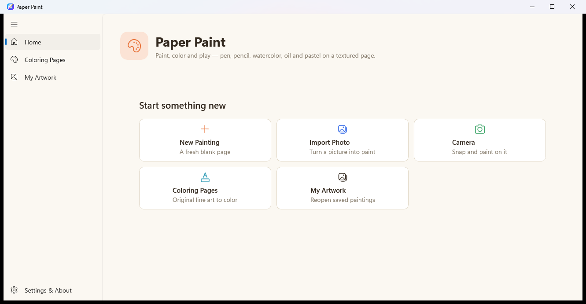

# 🎨 PaperPaint

> **A delightful, expressive digital painting and coloring studio for Windows 10 and 11.**

[](https://dotnet.microsoft.com/)
[](https://learn.microsoft.com/windows/apps/winui/winui3/)
[](https://github.com/microsoft/WindowsAppSDK)
[](LICENSE)
[](https://www.microsoft.com/windows)
[](https://github.com/uponatime2019/PaperPaint/releases/latest)

---

## ⚡ Try It Now (Zero Install, Portable Standalone)

No installer, no administrative privileges, and no Microsoft Store dependencies needed:

👉 **[Download Latest PaperPaint Portable (.zip)](https://github.com/uponatime2019/PaperPaint/releases/latest)**

1. Download `PaperPaint-*-win-x64.zip` from the latest release.
2. Extract the archive to any folder.
3. Launch `PaperPaint.exe` and start painting immediately!

---

## 📸 Screenshot



---

## ✨ Features

- 🖌️ **Natural Art Tools**:
  - **Pen**: Smooth vector-style ink with dynamic taper.
  - **Pencil**: Textured graphite simulation with pressure response.
  - **Watercolor**: Authentic wet paint with dynamic bloom and drying mechanics.
  - **Oil**: Rich, thick-impasto strokes with edge shading.
  - **Pastel**: Soft, chalky grain over textured paper fibers.
  - **Eraser**: Clean erasing preserving base layers.
- 🎨 **Coloring Gallery**:
  - Extensive procedural vector coloring book illustrations (Nature, Animals, Scenes, Objects).
  - Infinite resolution: vector line art scales cleanly without pixelation.
  - Color inside lines, tint, or paint freehand directly on pages.
- 🖼️ **Photo Import & Creative Filters**:
  - Import photos from disk or snap directly from your camera.
  - Instant artistic filters: **Sketch**, **Sepia**, **Monochrome (Black & White)**, and **Soft Blur**.
  - Paint on top of filtered base images with full layer isolation.
- 💾 **Personal Artwork Gallery**:
  - Automatic thumbnail generation and metadata indexing.
  - Local, offline storage under `%LOCALAPPDATA%\PaperPaint\Artwork`.
  - Reopen previous sessions, rename paintings, or clean up projects.
- 📤 **Save, Export, Share & Print**:
  - Save project state or export to clean PNG and JPEG formats.
  - Native Windows Share Sheet integration (`ShareAsync`).
  - Native Windows system printing dialog integration (`PrintAsync`).
- 🔒 **100% Local & Privacy First**:
  - Zero telemetry, zero analytics tracking, and zero remote network calls.
  - Your artwork and settings remain strictly on your device.

---

## ⌨️ Keyboard Shortcuts & Input Controls

| Action | Shortcut / Input |
|---|---|
| **Undo** | <kbd>Ctrl</kbd> + <kbd>Z</kbd> |
| **Redo** | <kbd>Ctrl</kbd> + <kbd>Y</kbd> or <kbd>Ctrl</kbd> + <kbd>Shift</kbd> + <kbd>Z</kbd> |
| **Save Painting** | <kbd>Ctrl</kbd> + <kbd>S</kbd> |
| **Export Image** | <kbd>Ctrl</kbd> + <kbd>E</kbd> |
| **Print Painting** | <kbd>Ctrl</kbd> + <kbd>P</kbd> |
| **Import Photo** | <kbd>Ctrl</kbd> + <kbd>O</kbd> |
| **Dry Paint (Watercolors)** | <kbd>Ctrl</kbd> + <kbd>D</kbd> |
| **Fit Canvas to Window** | <kbd>Ctrl</kbd> + <kbd>0</kbd> |
| **Tool Shortcuts** | <kbd>1</kbd> Pen · <kbd>2</kbd> Pencil · <kbd>3</kbd> Watercolor · <kbd>4</kbd> Oil · <kbd>5</kbd> Pastel · <kbd>6</kbd> Eraser |
| **Mouse Interaction** | Left-click: paint · Middle-click / Right-drag: pan canvas · Scroll wheel: zoom |
| **Stylus / Pen** | Pressure-sensitive stroke width · Barrel button / Right-click: pan |
| **Touch Interaction** | 1 finger: draw · 2 fingers: pinch to zoom and pan |

---

## 🏛️ Architecture & Tech Stack

PaperPaint is built from the ground up as a modern, lightweight Windows desktop application:

- **Framework**: [WinUI 3](https://learn.microsoft.com/windows/apps/winui/winui3/) with **Windows App SDK**.
- **Runtime**: Pure unpackaged (`<WindowsPackageType>None</WindowsPackageType>`), self-contained .NET 8.
- **Graphics Acceleration**: [Win2D (Microsoft.Graphics.Win2D)](https://github.com/microsoft/Win2D) delivering Direct2D / DirectX hardware-accelerated canvas rendering at 60+ FPS.
- **Image Operations**: Windows.Graphics.Imaging pipeline for high-throughput pixel manipulation and encoding.
- **Window Management**: Windows App SDK `AppWindow` with Mica backdrop and PerMonitorV2 DPI awareness.

```
PaperPaint/
├── App.xaml / App.xaml.cs          # Application entry point & unhandled exception routing
├── MainWindow.xaml / .cs           # Mica shell window with navigation rail
├── Views/
│   ├── HomePage.xaml / .cs         # Hero hub and recent artwork shelf
│   ├── StudioPage.xaml / .cs       # Painting studio canvas, palette, and tools UI
│   ├── StudioPage.Paint.cs         # Win2D hardware-accelerated rendering engine
│   ├── StudioPage.IO.cs            # Composition rendering, PNG export, share & print
│   ├── ColoringGalleryPage.xaml    # Vector coloring illustration browser
│   ├── EffectsPage.xaml            # Photo import, camera preview, and image filters
│   ├── ArtworkPage.xaml            # Saved artwork library manager
│   ├── SettingsPage.xaml           # Input guide, shortcuts, and app details
│   └── CameraDialog.xaml           # MediaCapture live camera snapshot dialog
├── Services/
│   ├── ColoringArt.cs              # Procedural vector line-art drawing engine
│   ├── ArtworkStore.cs             # Indexing and storage management
│   ├── ImageEffects.cs             # Fast software pixel shaders (sketch, sepia, blur)
│   └── SharePrintService.cs        # Windows Share Sheet and Print Document contract
└── Helpers/
    ├── ImageOps.cs                 # Bitmap resize, fit, and BGRA conversions
    ├── Nav.cs                      # Shell navigation dispatcher
    ├── WindowHelper.cs             # Win32 DPI scaling, icons, and presenter helpers
    └── AppSettingsHelper.cs        # LocalAppData JSON settings persistence
```

---

## 🛠️ Building from Source

### Prerequisites

- **OS**: Windows 10 (Version 1809+ / Build 17763+) or Windows 11.
- **SDK**: [.NET 8.0 SDK](https://dotnet.microsoft.com/download/dotnet/8.0) or newer.
- **IDE**: [Visual Studio 2022](https://visualstudio.microsoft.com/) (v17.8+) with the **.NET Desktop Development** workload.

### Build and Run

1. Clone the repository:
   ```bash
   git clone https://github.com/uponatime2019/PaperPaint.git
   cd PaperPaint
   ```

2. Build with .NET CLI:
   ```powershell
   dotnet build "PaperPaint.csproj" -p:Platform=x64
   ```

3. Run the application:
   ```powershell
   dotnet run --project "PaperPaint.csproj" -p:Platform=x64
   ```

4. Or open `PaperPaint.sln` directly in Visual Studio and press <kbd>F5</kbd>.

---

## 🗺️ Roadmap

- [x] Pure unpackaged WinUI 3 architecture with zero store dependencies
- [x] Hardware-accelerated Win2D canvas rendering with multi-layer compositing
- [x] Pressure-sensitive stylus and touch gestures (pinch-zoom, two-finger pan)
- [x] Built-in vector coloring gallery with category filters
- [x] Photo import, camera snapshot, and visual effects (Sketch, Sepia, Monochrome, Blur)
- [x] Unpackaged LocalAppData persistence and standalone portable release workflow
- [ ] Layer panel with reordering, opacity controls, and blend modes
- [ ] Custom stamp and texture brushes (Airbrush, Calligraphy, Sponge)
- [ ] Eyedropper tool to sample colors directly from canvas
- [ ] Export to animated stroke replay GIF / MP4
- [ ] Multi-language localization support

---

## 🤝 Contributing

Contributions are what make the open-source community an amazing place to learn, inspire, and create. Any contributions you make are **greatly appreciated**!

1. Fork the Project
2. Create your Feature Branch (`git checkout -b feature/AmazingFeature`)
3. Commit your Changes (`git commit -m 'Add some AmazingFeature'`)
4. Push to the Branch (`git push origin feature/AmazingFeature`)
5. Open a Pull Request

Please read our [Contributing Guidelines](CONTRIBUTING.md) for details on code standards and development setup.

---

## 📄 License

Distributed under the MIT License. See [LICENSE](LICENSE) for more information.

---

<p align="center">Made with ❤️ for creative artists everywhere.</p>
